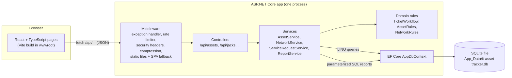
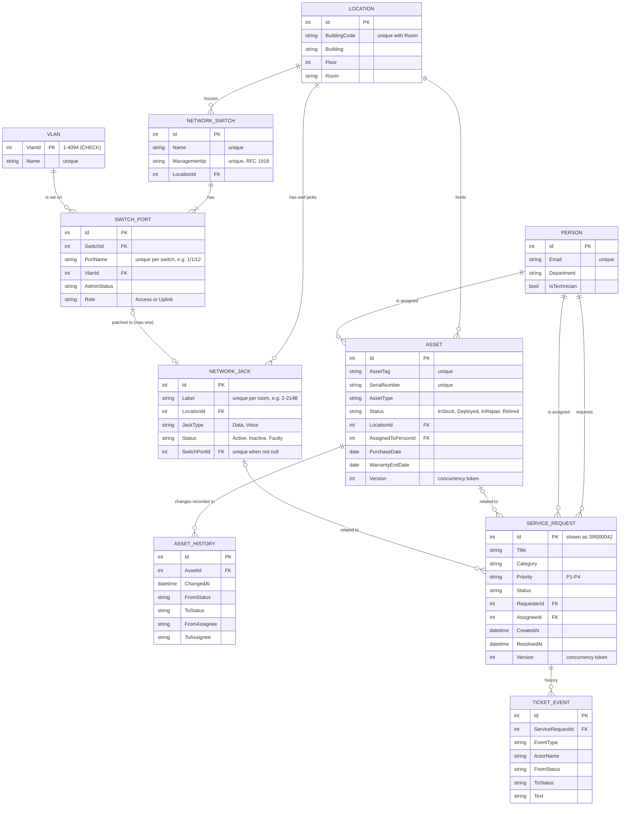
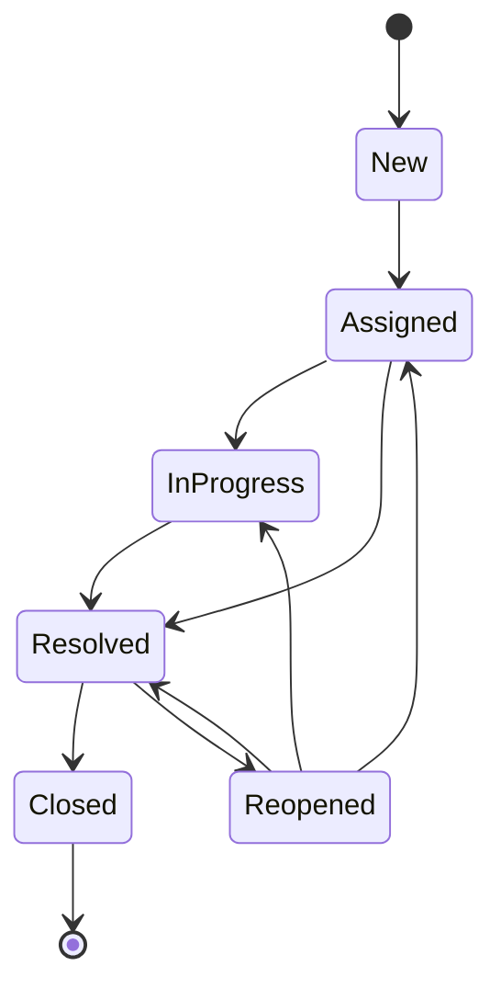

# IT Asset & Service Request Tracker

A web app for an IT department to keep track of its equipment, its network wall jacks and switch
ports, and the service requests (tickets) it works on. The backend is an ASP.NET Core Web API in
C# with Entity Framework Core and SQLite. The frontend is React with TypeScript and Tailwind CSS.

All of the data belongs to **Alder Creek College**, a made-up organization. Every person, room,
device, serial number and ticket was made up by the app's demo seeder. Email addresses use the
reserved `.example` domain. Nothing comes from a real school or company.

> Live demo: https://it-asset-service-request-tracker.onrender.com
> Render's free plan puts the service to sleep after 15 minutes idle, the first visit after that takes about 50 seconds, and the demo data resets on every restart. (See [Verification status](#verification-status).)

## Contents

- [Objectives](#objectives)
- [Technologies and why each one is used](#technologies-and-why-each-one-is-used)
- [Features](#features)
- [Architecture](#architecture)
- [Data model](#data-model)
- [Project structure](#project-structure)
- [Setup](#setup)
- [Running the local demo](#running-the-local-demo)
- [Configuration](#configuration)
- [API overview](#api-overview)
- [Implementation details](#implementation-details)
- [SQL reports](#sql-reports)
- [Testing](#testing)
- [Recording a demo video](#recording-a-demo-video)
- [Hosting and deployment](#hosting-and-deployment)
- [Verification status](#verification-status)
- [Known limitations](#known-limitations)
- [Challenges the design solves](#challenges-the-design-solves)
- [What's next](#whats-next)
- [Troubleshooting](#troubleshooting)
- [License and credits](#license-and-credits)

More detail on how a request moves through the code, plus interview practice questions, is in
[docs/WALKTHROUGH.md](docs/WALKTHROUGH.md).

## Objectives

1. Keep an equipment inventory with full create, read, update and delete, where every change to
   an asset's status, location or assigned person is recorded.
2. Model campus network cabling the way a telecom team works with it: wall jacks are patched to
   switch ports, and ports are put on VLANs. "Activate jack 2-214B" should be one action.
3. Run service requests through a fixed lifecycle (New, Assigned, In progress, Resolved, Closed,
   Reopened) with assignment, comments and a full history.
4. Enforce every rule on the server, not just in the browser.
5. Answer real questions with SQL (warranty expirations, ticket aging, resolution time, port use).
6. Make every number on the screen come from the database.

## Technologies and why each one is used

| Technology | Version | Why it is here |
| --- | --- | --- |
| C# / .NET | SDK 10.0.404, runtime 10.0.15 | Language and runtime for the API. |
| ASP.NET Core Web API (controllers) | 10.0 | HTTP endpoints, model validation, ProblemDetails error responses, rate limiting, static file hosting for the React build. |
| Entity Framework Core + SQLite provider | 10.0.15 | Maps C# classes to tables, generates the schema through migrations, and runs the parameterized report SQL. SQLite needs no server, so the demo runs anywhere. |
| SQL | SQLite dialect | The eight reports are hand-written SQL queries (joins, GROUP BY, CTEs, date math). |
| Microsoft.AspNetCore.OpenApi | 10.0.15 | The built-in OpenAPI document at `/openapi/v1.json` (Development only). Swashbuckle is not used. |
| React | 19.3.1 | UI components for the dashboard, forms and tables. |
| TypeScript | 7.0.2 | Types for every API response, so a renamed field is a compile error instead of a blank cell. |
| Vite | 8.3.8 | Dev server with a proxy to the API, and the production build. |
| Tailwind CSS | 4.3.5 | Styling for the dark, responsive layout without a separate CSS framework. |
| React Router | 8.5.2 | Page routes such as `/assets/42` that survive a browser refresh. |
| xUnit + Microsoft.AspNetCore.Mvc.Testing | 2.9.3 / 10.0.15 | Unit tests for the business rules and integration tests that start the real API against a real SQLite file. |
| Vitest + Testing Library + jsdom | 5.1.1 / 16.3.3 / 31.0.1 | Component tests that render the real React pages and only fake `fetch`. |
| oxlint | 1.94.0 | Lint checks for the React code (came with the Vite template). |
| GitHub Actions | checkout v7, setup-dotnet v6, setup-node v7 | Runs the backend tests, the frontend checks and a Docker build whenever this app's folder changes. |
| Docker | node 26.13.0, dotnet sdk 10.0.404, aspnet 10.0.15 images | One image that contains the API and the built client, for hosting. |

## Features

Everything listed here is implemented and works against the API.

**Dashboard**
- Asset totals, warranties ending in 30 days, open requests, open P1 requests, requests resolved in
  the last 7 days and average hours to resolve (last 30 days), all queried live.
- Bar charts for assets by status and open requests by priority, jack and port usage, and the six
  newest requests.

**Equipment inventory**
- Search by asset tag, serial number, manufacturer, model or assigned person.
- Filter by status, type and building; sort by any column; 25 per page. Filters are kept in the URL.
- Create, edit and delete assets with field-level validation messages from both the browser and the server.
- Assignment history for each asset (status, location and person changes, with an optional note).
- Optimistic concurrency: if two people edit the same asset, the second save gets a clear 409 message.

**Network**
- Switches with management IP (private IPv4 only), location and port count. Creating a switch
  creates its ports (`1/1/1` to `1/1/N`).
- Every port has a role: **Access** (takes a wall jack) or **Uplink** (connects the switch to the
  core network). In the demo data the last port of each switch is its uplink. Uplinks are labelled
  in the port table, are never offered for patching, and cannot be disabled or moved to another VLAN.
- Port table per switch: change VLAN, enable or disable the port, edit the description, unpatch a jack.
- Jacks with search and filters, create, edit and delete.
- **Activate** a jack in one step: patch it to a free access port, put the port on a VLAN, enable the
  port and mark the jack Active. **Patch only** and **Unpatch** are also available. If a switch has no
  free access ports, the dialog says so instead of showing an empty list.
- VLAN list (IDs 1-4094) with add and delete.

**Service requests**
- List with search (including SR numbers like `SR000042`), filters for status, priority, category
  and assignee, open-only view, sorting and paging.
- Create and edit requests, optionally linked to an asset or a jack.
- Assign or reassign to a technician ("Assign to me" included).
- Status buttons show only the next steps the server allows. Resolving needs resolution notes;
  reopening needs a reason.
- Comments and a history timeline of every change.

**Reports**
- Eight SQL reports, each with a bar chart, a table, **Show SQL** and **Export CSV**.

**People and locations**
- Create, edit and remove people (and mark technicians) and rooms. Records that are still in use
  cannot be removed.

**About this demo**
- Row counts from the database and a **Reset demo data** button (enabled in Development).

## Architecture



In development the Vite dev server (port 5202) serves the React code with hot reload and forwards
`/api` calls to the API on port 5201. For the demo and for hosting, the React build is copied into
the API's `wwwroot`, so one process serves both the pages and the API on one origin.

## Data model



Enums are stored as text (`'Deployed'`, `'P1'`) so the SQL reports and the raw database are readable.
Dates are stored as UTC.

## Project structure

```text
apps/it-asset-service-request-tracker/
├── src/ItAssetTracker.Api/          ASP.NET Core Web API
│   ├── Controllers/                 HTTP endpoints (thin: call a service, return the result)
│   ├── Services/                    Business logic, queries, ReportQueries.cs (the SQL)
│   ├── Domain/                      Entities, enums, rule classes, domain exceptions
│   ├── Contracts/                   Request/response DTOs with validation attributes
│   ├── Data/                        AppDbContext, migrations, demo seeder, startup initializer
│   ├── Infrastructure/              ProblemDetails mapping, health check, PORT handling
│   ├── Program.cs                   Service registration and middleware pipeline
│   └── wwwroot/                     React build output (built locally, not committed)
├── tests/ItAssetTracker.Tests/
│   ├── Unit/                        Workflow, asset and network rule tests
│   └── Integration/                 WebApplicationFactory tests against real SQLite files
├── client/                          React + TypeScript + Vite + Tailwind
│   └── src/  api/ components/ context/ hooks/ lib/ pages/ test/
├── docs/                            WALKTHROUGH.md, screenshots/README.md
├── Dockerfile, .dockerignore        Container build for hosting
├── run-demo.ps1, run-demo.sh        One-command local demo
├── ItAssetTracker.slnx              Solution file
├── nuget.config                     Uses nuget.org for this project only
└── dotnet-tools.json                Local tool manifest (dotnet-ef 10.0.15)
```

## Setup

### Prerequisites

- [.NET SDK 10](https://dotnet.microsoft.com/download) (built with 10.0.404). Check with `dotnet --version`.
- [Node.js](https://nodejs.org/) 22.22.2+, 24.15+ or 26+ with npm (the test tools require one of these;
  built and tested with 26.13.0). Check with `node --version`.
- Git, to clone the repository.

Nothing is installed globally. The `dotnet-ef` tool is a local tool listed in `dotnet-tools.json`.

### First-time setup

```bash
git clone https://github.com/enobot/nate.git
cd nate/apps/it-asset-service-request-tracker

dotnet restore ItAssetTracker.slnx
dotnet tool restore            # installs the local dotnet-ef tool

cd client
npm ci
cd ..
```

The app lives in `apps/it-asset-service-request-tracker/` of the [enobot/nate](https://github.com/enobot/nate)
repository. Every command in this README is run from this app folder, and nothing depends on the
repository root. Its CI workflow is at the repository root in
[`.github/workflows/asset-tracker.yml`](../../.github/workflows/asset-tracker.yml) and runs when this folder changes.

## Running the local demo

### One command

Windows PowerShell:

```powershell
powershell -ExecutionPolicy Bypass -File .\run-demo.ps1
```

macOS, Linux or Git Bash:

```bash
bash run-demo.sh
```

Each script runs `npm ci`, builds the React client into `src/ItAssetTracker.Api/wwwroot`, then
starts the app. Open **http://localhost:5201**. Press `Ctrl+C` to stop.

### The same thing step by step

```bash
cd client
npm run build                    # writes the client into src/ItAssetTracker.Api/wwwroot
cd ..
dotnet run --project src/ItAssetTracker.Api
```

On first start the app creates `src/ItAssetTracker.Api/App_Data/it-asset-tracker.db`, applies the
EF Core migrations and loads the demo data. An existing database file is upgraded in place by any
new migrations the next time the app starts. The file is kept between runs, so your changes are still
there after a refresh or a restart.

To start over with fresh demo data, either click **Reset demo data** on the **About this demo** page,
or run:

```bash
dotnet run --project src/ItAssetTracker.Api -- --reset-demo
```

### Frontend development mode (hot reload)

Run the API and the Vite dev server in two terminals:

```bash
dotnet run --project src/ItAssetTracker.Api      # terminal 1: API on http://localhost:5201
cd client && npm run dev                          # terminal 2: UI on http://localhost:5202
```

Open http://localhost:5202. Vite forwards `/api` requests to port 5201.

### Database commands

```bash
dotnet tool restore
dotnet ef migrations list --project src/ItAssetTracker.Api
dotnet ef database update --project src/ItAssetTracker.Api      # apply migrations without starting the app
dotnet ef migrations add <Name> --project src/ItAssetTracker.Api --output-dir Data/Migrations
```

## Configuration

Settings live in `src/ItAssetTracker.Api/appsettings.json` (all environments) and
`appsettings.Development.json` (overrides used by `dotnet run`). Any setting can also be set with an
environment variable, using `__` between sections (for example `Demo__EnableResetEndpoint=true`).

| Setting | Default | Development | Meaning |
| --- | --- | --- | --- |
| `ConnectionStrings:Default` | `Data Source=App_Data/it-asset-tracker.db` | same | SQLite file. A relative path is placed under the app folder. |
| `Database:MigrateOnStartup` | `true` | `true` | Create the database file and apply migrations at startup. |
| `Demo:SeedOnStartup` | `true` | `true` | Load the demo data when the database is empty. |
| `Demo:EnableResetEndpoint` | `false` | `true` | Allow `POST /api/demo/reset` (and the Reset button). |
| `RateLimiting:WritesPerMinute` | `60` | `0` (off) | Max POST/PUT/DELETE requests per client IP per minute. |
| `Cors:AllowedOrigins` | none | `http://localhost:5202` | Origins allowed to call the API from another port. |
| `PORT` (environment variable) | not set | not set | If set, listen on all interfaces on this port. |

How the listening address is chosen (see `Infrastructure/HostingDefaults.cs`):

1. If `PORT` is set, the app listens on `http://+:<PORT>`.
2. Otherwise, if one of the standard ASP.NET Core settings is present (`ASPNETCORE_URLS`, `--urls`,
   `ASPNETCORE_HTTP_PORTS`), it is used as normal. `dotnet run` sets `http://localhost:5201` from
   `launchSettings.json`, and the official container image sets port 8080.
3. Otherwise it listens on `http://localhost:5201`.

## API overview

All endpoints are under `/api` and use JSON. Errors use the RFC 9457 ProblemDetails format
(`application/problem+json`). In Development the OpenAPI document is at `/openapi/v1.json`.

| Area | Endpoints |
| --- | --- |
| Health | `GET /api/health` |
| Dashboard | `GET /api/dashboard` |
| Assets | `GET /api/assets` (search, filters, sort, paging), `GET /api/assets/{id}`, `GET /api/assets/{id}/history`, `POST /api/assets`, `PUT /api/assets/{id}`, `DELETE /api/assets/{id}` |
| Locations | `GET /api/locations`, `POST`, `PUT /{id}`, `DELETE /{id}` |
| People | `GET /api/people?technicianOnly=&search=`, `POST`, `PUT /{id}`, `DELETE /{id}` |
| VLANs | `GET /api/vlans`, `POST /api/vlans`, `DELETE /api/vlans/{vlanId}` |
| Switches | `GET /api/switches`, `GET /api/switches/{id}` (with ports), `GET /api/switches/{id}/free-ports` (unpatched access ports only), `POST`, `PUT /{id}`, `DELETE /{id}` |
| Ports | `PUT /api/ports/{id}` (VLAN, admin status, description) |
| Jacks | `GET /api/jacks`, `GET /{id}`, `POST`, `PUT /{id}`, `DELETE /{id}`, `POST /{id}/patch`, `POST /{id}/unpatch`, `POST /{id}/activate` |
| Service requests | `GET /api/service-requests`, `GET /{id}`, `POST`, `PUT /{id}`, `POST /{id}/assign`, `POST /{id}/status`, `POST /{id}/comments` |
| Reports | `GET /api/reports/definitions` and the eight report endpoints listed under [SQL reports](#sql-reports) |
| Demo | `GET /api/demo`, `POST /api/demo/reset` |

Status codes used:

| Code | When |
| --- | --- |
| 200 OK / 201 Created / 204 No Content | Successful read or update / create (with a `Location` header) / delete |
| 400 Bad Request | Invalid input: missing or too-long fields, bad formats, VLAN outside 1-4094, a rule like "a deployed asset needs a location", or a reference to a row that does not exist. Includes an `errors` object keyed by field name. |
| 404 Not Found | The id in the URL does not exist, or an unknown `/api/...` path |
| 409 Conflict | Duplicate asset tag/serial/name, a status change the workflow does not allow, a port that already has a jack, a jack patched into an uplink port, disabling or re-VLANing an uplink, a stale `version` (someone else saved first), or deleting something still in use |
| 429 Too Many Requests | Write rate limit reached (Production default 60 per minute per client) |
| 500 | Unexpected errors, returned as ProblemDetails without a stack trace |

There is no DELETE for service requests on purpose: tickets are an audit trail, so they are closed
instead of deleted.

## Implementation details

**Validation happens in three layers.**
1. The React forms check required fields and formats before sending, so people get instant feedback.
2. Request DTOs use DataAnnotations (`[Required]`, `[StringLength]`, `[Range]`, `[RegularExpression]`,
   `[EnumDataType]`). `[ApiController]` turns failures into a 400 automatically. Enums must be sent
   as names; numbers like `99` are rejected.
3. Rules that need the database or several fields at once live in `Domain/Rules` and the services,
   and throw `BusinessRuleException` (400), `ConflictException` (409) or `NotFoundException` (404).
   `ProblemExceptionHandler` maps those to ProblemDetails.

The server never trusts the browser: the client checks are only for convenience.

**Ticket lifecycle** (`Domain/Rules/TicketWorkflow.cs`) is a lookup table of allowed moves:



Assigned, In progress and Resolved require an assignee. Resolved requires resolution notes; Reopened
requires a reason. Closed is final. Assigning a New or Reopened request moves it to Assigned and
records both events. The API returns `allowedTransitions` with every request, so the UI draws only
valid buttons, but the server checks again on every call.

**Network rules** (`Domain/Rules/NetworkRules.cs`):
- VLAN IDs must be 1-4094 (0 and 4095 are reserved in 802.1Q). This is checked in code and by a
  CHECK constraint in the database.
- A port can have at most one jack: `NetworkJacks.SwitchPortId` has a unique index (filtered to
  non-null values). Because the link is a single column, a jack can never point at two ports.
- Ports have a role (`Access` or `Uplink`). A jack can only be patched or activated on an access
  port; trying an uplink returns 409, because patching a wall jack into the uplink would cut the
  switch off from the core. Through the port edit endpoint an uplink keeps its status (Enabled) and
  VLAN; only its description can change. The free-ports endpoint and the utilization numbers count
  access ports only.
- Faulty jacks cannot be patched. An Active jack must be patched to an enabled port with a VLAN.
  Unpatching an Active jack sets it to Inactive. A port serving an Active jack cannot be disabled
  or lose its VLAN.
- Switch management addresses must be RFC 1918 private IPv4.

**Asset rules** (`Domain/Rules/AssetRules.cs`): only Deployed assets can be assigned to a person; a
Deployed asset needs a location; the purchase date cannot be in the future; the warranty cannot end
before the purchase; Retired is final. Asset tags and serials are trimmed and upper-cased, and both
have unique indexes.

**Duplicates and races.** Each service checks for an existing tag/serial/name first so it can return
a specific message. If two requests pass that check at the same moment, the unique index makes the
second insert fail, and the exception handler turns the SQLite constraint error into a 409.

**Optimistic concurrency.** Assets and service requests have a `Version` column marked as a
concurrency token. The client sends back the version it loaded. EF Core adds
`WHERE Version = @old` to the UPDATE, so a save based on stale data changes zero rows and returns 409.
Comments do not bump the version, so adding a note does not block someone else's edit.

**Audit history.** Asset changes write `AssetHistory` rows and ticket changes write `TicketEvent`
rows. Names are stored as text snapshots, so the history still reads correctly after a person is
renamed or removed.

**Seed data** (`Data/DemoDataSeeder.cs`) uses a fixed random seed, so every reset produces the same
data: 300 assets, 60 people, 67 locations, 6 switches with 216 ports (the last port of each switch
is its uplink, so 210 are access ports), 177 jacks, 7 VLANs and 100 service requests with their
history. Dates are calculated back from the moment of seeding so ticket
ages and warranty windows stay realistic. The seed data follows the same rules the API enforces, and
a test checks that.

**Security basics.** All SQL is parameterized (LINQ, or report SQL with `{0}` placeholders that EF
Core turns into parameters). Request bodies over 1 MB are rejected and every string field has a
maximum length. LIKE wildcards in search text are escaped. Responses include
`Content-Security-Policy`, `X-Content-Type-Options`, `X-Frame-Options` and `Referrer-Policy`. CORS is
only opened for the Vite dev server in Development. There are no secrets in the repository. Write
requests are rate limited per client IP outside Development.

**Performance work.** Common filter columns have indexes (asset status and warranty date; request
status, priority, created date and assignee). Lists are paged (max 100 per page). JSON and the
JavaScript bundle are compressed (Brotli or gzip), and Vite's hashed files under `/static` are cached
for a year while `index.html` is always revalidated. Measured on Windows 11, localhost, Release build
after warm-up, using `curl` timing (5 requests each): `/api/dashboard`, `/api/assets?pageSize=25` and
`/api/reports/jack-utilization` each answered in about 6-11 ms; the first request after startup took
about 120 ms. The JS bundle is 365.8 KB raw, 106.9 KB gzip (Vite's report) and 139.9 KB as served
with Brotli at ASP.NET Core's default (fastest) level. Browser metrics such as LCP and INP were not
measured.

## SQL reports

Each report is a constant in `src/ItAssetTracker.Api/Services/ReportQueries.cs`. EF Core runs it
with `Database.SqlQuery<T>(FormattableString)`, which replaces every `{0}`, `{1}` placeholder with a
real DbParameter (`@p0`, `@p1`). The **Show SQL** button on the Reports page displays the same text,
returned by `GET /api/reports/definitions`. The queries use SQLite's `julianday()` for date math.

### 1. Assets by status (`GET /api/reports/assets-by-status`)

```sql
SELECT a.Status AS Label,
       COUNT(*) AS Count
FROM Assets a
GROUP BY a.Status
ORDER BY Count DESC, Label
```

### 2. Assets by building (`GET /api/reports/assets-by-building`)

```sql
SELECT COALESCE(l.Building, '(No location)') AS Building,
       COUNT(*) AS Total,
       SUM(CASE WHEN a.Status = 'Deployed' THEN 1 ELSE 0 END) AS Deployed,
       SUM(CASE WHEN a.Status = 'InStock'  THEN 1 ELSE 0 END) AS InStock,
       SUM(CASE WHEN a.Status = 'InRepair' THEN 1 ELSE 0 END) AS InRepair,
       SUM(CASE WHEN a.Status = 'Retired'  THEN 1 ELSE 0 END) AS Retired
FROM Assets a
LEFT JOIN Locations l ON l.Id = a.LocationId
GROUP BY COALESCE(l.Building, '(No location)')
ORDER BY Total DESC, Building
```

### 3. Warranty expiring (`GET /api/reports/warranty-expiring?days=90`)

`{0}` is today's date and `{1}` is today plus `days` (1-730).

```sql
SELECT a.Id AS AssetId,
       a.AssetTag,
       a.AssetType,
       a.Manufacturer,
       a.Model,
       a.Status,
       a.WarrantyEndDate,
       CAST(julianday(a.WarrantyEndDate) - julianday({0}) AS INTEGER) AS DaysRemaining,
       COALESCE(l.BuildingCode || ' ' || l.Room, '') AS Location,
       COALESCE(p.FirstName || ' ' || p.LastName, '') AS AssignedTo
FROM Assets a
LEFT JOIN Locations l ON l.Id = a.LocationId
LEFT JOIN People p ON p.Id = a.AssignedToPersonId
WHERE a.Status <> 'Retired'
  AND a.WarrantyEndDate IS NOT NULL
  AND a.WarrantyEndDate >= {0}
  AND a.WarrantyEndDate <= {1}
ORDER BY a.WarrantyEndDate, a.AssetTag
```

### 4. Open requests by priority (`GET /api/reports/open-tickets-by-priority`)

`{0}` is the current UTC time. The CTE makes sure all four priorities appear even with zero rows.

```sql
WITH priorities(Priority) AS (VALUES ('P1'), ('P2'), ('P3'), ('P4'))
SELECT pr.Priority AS Priority,
       COUNT(sr.Id) AS OpenCount,
       COALESCE(SUM(CASE WHEN sr.Id IS NOT NULL AND sr.AssigneeId IS NULL THEN 1 ELSE 0 END), 0) AS Unassigned,
       ROUND(AVG(julianday({0}) - julianday(sr.CreatedAt)), 1) AS AvgAgeDays
FROM priorities pr
LEFT JOIN ServiceRequests sr
       ON sr.Priority = pr.Priority
      AND sr.Status NOT IN ('Resolved', 'Closed')
GROUP BY pr.Priority
ORDER BY pr.Priority
```

### 5. Open request aging (`GET /api/reports/ticket-aging`)

`{0}` is the current UTC time.

```sql
WITH buckets(SortOrder, Bucket, MinDays, MaxDays) AS (
    VALUES (1, 'Under 1 day', 0, 1),
           (2, '1-3 days', 1, 3),
           (3, '3-7 days', 3, 7),
           (4, '7-30 days', 7, 30),
           (5, 'Over 30 days', 30, 100000)
)
SELECT b.SortOrder,
       b.Bucket,
       COUNT(sr.Id) AS Count
FROM buckets b
LEFT JOIN ServiceRequests sr
       ON sr.Status NOT IN ('Resolved', 'Closed')
      AND julianday({0}) - julianday(sr.CreatedAt) >= b.MinDays
      AND julianday({0}) - julianday(sr.CreatedAt) <  b.MaxDays
GROUP BY b.SortOrder, b.Bucket
ORDER BY b.SortOrder
```

### 6. Time to resolve by category (`GET /api/reports/resolution-time`)

```sql
SELECT sr.Category AS Category,
       COUNT(*) AS ResolvedCount,
       ROUND(AVG((julianday(sr.ResolvedAt) - julianday(sr.CreatedAt)) * 24.0), 1) AS AvgHoursToResolve,
       ROUND(MIN((julianday(sr.ResolvedAt) - julianday(sr.CreatedAt)) * 24.0), 1) AS MinHoursToResolve,
       ROUND(MAX((julianday(sr.ResolvedAt) - julianday(sr.CreatedAt)) * 24.0), 1) AS MaxHoursToResolve
FROM ServiceRequests sr
WHERE sr.ResolvedAt IS NOT NULL
  AND sr.Status IN ('Resolved', 'Closed')
GROUP BY sr.Category
ORDER BY AvgHoursToResolve DESC, Category
```

### 7. Jack utilization per switch (`GET /api/reports/jack-utilization`)

Only access ports are counted, because an uplink never takes a jack. Putting `p.Role = 'Access'` in
the join (not in WHERE) keeps switches with no access ports in the result with zero counts.

```sql
SELECT s.Id AS SwitchId,
       s.Name AS SwitchName,
       l.Building AS Building,
       COUNT(p.Id) AS AccessPorts,
       COUNT(j.Id) AS PatchedPorts,
       COALESCE(SUM(CASE WHEN j.Status = 'Active' THEN 1 ELSE 0 END), 0) AS ActiveJacks,
       COALESCE(ROUND(100.0 * COUNT(j.Id) / NULLIF(COUNT(p.Id), 0), 1), 0.0) AS UtilizationPercent
FROM NetworkSwitches s
JOIN Locations l ON l.Id = s.LocationId
LEFT JOIN SwitchPorts p ON p.SwitchId = s.Id AND p.Role = 'Access'
LEFT JOIN NetworkJacks j ON j.SwitchPortId = p.Id
GROUP BY s.Id, s.Name, l.Building
ORDER BY s.Name
```

### 8. Technician workload (`GET /api/reports/technician-workload`)

`{0}` is 30 days before now.

```sql
SELECT p.Id AS PersonId,
       p.FirstName || ' ' || p.LastName AS Technician,
       COALESCE(SUM(CASE WHEN sr.Status IN ('Assigned', 'InProgress', 'Reopened') THEN 1 ELSE 0 END), 0) AS OpenAssigned,
       COALESCE(SUM(CASE WHEN sr.Status = 'InProgress' THEN 1 ELSE 0 END), 0) AS InProgress,
       COALESCE(SUM(CASE WHEN sr.Status IN ('Resolved', 'Closed') AND sr.ResolvedAt >= {0} THEN 1 ELSE 0 END), 0) AS ResolvedLast30Days
FROM People p
LEFT JOIN ServiceRequests sr ON sr.AssigneeId = p.Id
WHERE p.IsTechnician = 1
GROUP BY p.Id, p.FirstName, p.LastName
ORDER BY OpenAssigned DESC, Technician
```

The dashboard's "average hours to resolve" uses one more query, `AverageResolutionHoursSince`, in the
same file. The other dashboard numbers are EF Core LINQ counts.

## Testing

### Commands

```bash
# Backend: 191 xUnit tests (unit + integration)
dotnet test ItAssetTracker.slnx

# Backend line coverage (writes a Cobertura XML file under TestResults/)
dotnet test ItAssetTracker.slnx --collect:"XPlat Code Coverage"

# Frontend (run inside client/)
npm run typecheck     # tsc -b
npm run lint          # oxlint
npm test              # 40 Vitest tests
npm run build         # type-check + production build into the API's wwwroot
```

### What the tests cover

**Backend unit tests** (`tests/ItAssetTracker.Tests/Unit`)
- Every from/to pair of ticket statuses (36 combinations) against the documented lifecycle, plus
  assignee, resolution-note and reopen-reason rules.
- Asset rules: assignment only when deployed, location for deployed assets, date rules, Retired is final.
- VLAN range edges (0, 1, 4094, 4095), RFC 1918 address checks, every jack patching rule, and the
  uplink rules (no jack on an uplink; an uplink cannot be disabled or moved to another VLAN).
- How the listening port is chosen from `PORT` and the standard settings.

**Backend integration tests** (`tests/ItAssetTracker.Tests/Integration`). Each test class starts the
real app with `WebApplicationFactory` against its own temporary SQLite file, created by the real
migrations, with a fixed clock:
- Asset create, read, update and delete; history; search, filters, sorting and paging; LIKE wildcard escaping.
- 400 ProblemDetails with field errors (missing fields, bad enums, bad formats, rule violations, unknown references).
- 409 for duplicate tags and serials (including different letter case), stale versions, Retired assets,
  deletes that would break history, and the unique index itself when the service check is bypassed.
- Network: switch creation with ports, private-IP validation, VLAN range and existence, activation,
  one jack per port, one port per jack, faulty jacks, port changes that would cut off an active jack,
  unpatching, 409 when patching or activating onto an uplink, the free-ports endpoint leaving out
  uplinks and patched ports, and uplink edits (status and VLAN blocked, description allowed).
- Service requests: the full lifecycle with history and timestamps, skipped steps (409), missing notes
  (400), reopen, technician-only assignment, no-op repeat assignment, stale versions, comments and edits.
- Every SQL report and the dashboard against a small hand-built dataset whose correct answers were
  worked out by hand (`Integration/TestData.cs`).
- The full demo seeder: row counts, exactly one uplink per switch (its last port, never patched), that
  it follows the API's rules, and that two resets produce identical data.
- Platform behavior: health check, JSON 404 for unknown `/api` paths, OpenAPI document, security
  headers, UTC dates, enum names in JSON, the 429 write limit, and a Production start against a
  missing database file (created, migrated and seeded).

Measured backend coverage, from the coverage command above (Debug build): 87.7% of lines in
hand-written API code (2,439 of 2,781 source lines, each file and line counted once, not counting
the generated files in `Data/Migrations/`), and 69.4% branch coverage overall as reported by coverlet.

**Frontend tests** (`client/src/**/*.test.ts(x)`). They render the real pages and the real API
client. Only `fetch` is replaced (`src/test/mockFetch.ts`).
- API client: ProblemDetails become `ApiError` with field errors; 204 handling; network failures.
- Asset form: client-side errors are announced and stop the request; a server 409 is shown; server
  field errors appear on the matching input; a successful create posts the right body and opens the detail page.
- Request detail: only server-allowed status buttons show; resolve requires notes; the status change
  sends the version and acting technician; a 409 message is shown.
- Activate jack dialog: ports come from the free-ports endpoint (never an uplink); "No free access
  ports on ADM-IDF1-SW01" is shown and the buttons are disabled when a switch is full; a 409 from the
  server is displayed.
- Dashboard: numbers come from the API response; error state with a working retry.
- Validation helpers, CSV export (quoting and formula neutralizing) and formatting.

Frontend coverage was not measured (no coverage package is installed).

### Results from the last run

| Check | Result |
| --- | --- |
| `dotnet build` | 0 warnings, 0 errors |
| `dotnet test` | 191 passed, 0 failed, 0 skipped |
| `npm run typecheck` | no errors |
| `npm run lint` | no findings |
| `npm test` | 40 passed in 6 files |
| `npm run build` | built (index.html, one CSS file, one JS file) |

## Recording a demo video

A 2-4 minute screen recording is plenty. Short checklist:

1. **Prepare.** Start the app (`run-demo.ps1` or `run-demo.sh`), open http://localhost:5201, go to
   **About this demo** and click **Reset demo data**. Close other tabs and turn on Do Not Disturb.
   Set the browser zoom to 100-110% so text is readable in the video.
2. **Pick a recorder.**
   - *Windows Snipping Tool*: press `Win + Shift + R`, drag over the browser window, click **Start**.
     Stop from the toolbar; the video is saved as MP4.
   - *OBS Studio* (free): add a **Window Capture** source for the browser, set output to MP4 under
     Settings > Output, and click **Start Recording**.
3. **Suggested flow.**
   1. Dashboard: point out that the numbers come from the database.
   2. Assets: search for "latitude", filter to Deployed, open one, show its assignment history.
   3. Edit that asset (change its location), save, and show the new history entry.
   4. Try to add an asset with an existing tag (for example `ACC-100001`) to show the 409 message.
   5. Network > Jacks: filter to Inactive, click **Activate** on a jack, pick a free port and VLAN 10.
      Open the switch page and show the port now enabled with the jack on it.
   6. Service requests: create a request for that jack, assign it, start work, resolve it with notes,
      and show the history timeline. Point out that only valid status buttons appear.
   7. Reports: change the warranty window, click **Show SQL**, and export a CSV.
   8. Refresh the browser to show the data persisted.
4. **Finish.** Trim the start and end, and keep the file name simple, such as `it-asset-tracker-demo.mp4`.

## Hosting and deployment

### Why GitHub Pages is not enough

GitHub Pages only serves static files (HTML, CSS, JavaScript). It cannot run a .NET process, so the
API, the business rules and the SQLite database cannot run there. The React build could be put on
Pages, but it would have no API to call, so this project is shipped as one container instead.

### Docker (included, not yet built)

The `Dockerfile` has three stages: a Node 26.13.0 stage builds the client, a .NET SDK 10.0.404 stage
publishes the API with the client in `wwwroot`, and the final ASP.NET Core 10.0.15 runtime image runs
as the image's non-root `app` user and listens on port 8080 (or on `PORT` if the host sets it). The
build context is this folder, so it also works when the app is a subfolder of a larger repository.

```bash
# From this folder
docker build -t it-asset-tracker .
docker run --rm -p 8080:8080 it-asset-tracker
# then open http://localhost:8080 and check http://localhost:8080/api/health

# From the root of the enobot/nate repository
docker build -t it-asset-tracker apps/it-asset-service-request-tracker

# Simulate a host that sets PORT
docker run --rm -e PORT=10000 -p 10000:10000 it-asset-tracker
```

Docker was not installed on the machine this was built on. The CI workflow's `docker build` job
builds the image on GitHub's Linux runners, and it passed on the first run. The image also runs
the live demo on Render (https://it-asset-service-request-tracker.onrender.com), where `/api/health` returns `Healthy`. To test it yourself: install Docker Desktop, run the commands above, and confirm that `/`
shows the dashboard and `/api/health` returns `Healthy`.

### Data on hosts without a persistent disk

The database is a file inside the container (`/app/App_Data/it-asset-tracker.db`). Many free or
small hosting plans give containers a temporary disk, so **every restart or redeploy starts with a
new database**: the app creates it, applies the migration and loads the demo data again, and any
changes made by visitors are lost. That is fine for a demo of fictional data. To keep data, mount a
persistent volume and point the connection string at it, for example
`ConnectionStrings__Default="Data Source=/data/it-asset-tracker.db"`.

### Environment variables for a hosted demo

| Variable | Suggested value | Why |
| --- | --- | --- |
| `PORT` | set by most hosts automatically | Port to listen on. |
| `ASPNETCORE_FORWARDEDHEADERS_ENABLED` | `true` when behind the host's proxy | Lets ASP.NET Core read the real client IP and scheme from `X-Forwarded-*` headers, which the rate limiter uses. |
| `Demo__EnableResetEndpoint` | `false` (default) | Leave off on a public site unless you want visitors to be able to reset. |
| `RateLimiting__WritesPerMinute` | `60` (default) | Writes allowed per client IP per minute. |
| `ConnectionStrings__Default` | only with a persistent disk | Database file location. |

### Hosting options (not done, not verified)

None of these have been set up or tested for this project. Check each provider's current pricing
and limits yourself; none are claimed here.

- **Azure App Service (Linux)** - Microsoft's host for ASP.NET Core; can run the container or a
  `dotnet publish` output. Check its docs for which folders keep data between restarts.
- **Azure Container Apps** - runs the Docker image; keeping the SQLite file would need a mounted volume.
- **Render, Railway or Fly.io** - container hosts that can build from a Dockerfile. Check how each one
  passes the port (many use a `PORT` variable, which this app reads) and whether a persistent disk is
  available on the plan you choose.
- **Google Cloud Run** - runs containers and passes the port in `PORT`; its container disk is not
  persistent, so the demo data would reset.

A move to a managed database (Azure SQL or PostgreSQL) would fix the data-reset issue; see
[What's next](#whats-next).

## Verification status

| Item | Status | Evidence |
| --- | --- | --- |
| Backend build, 191 tests | VERIFIED | `dotnet build` 0 warnings; `dotnet test` 191 passed |
| Frontend type-check, lint, 40 tests, build | VERIFIED | commands in [Testing](#testing) |
| Uplink ports cannot take a jack | VERIFIED | tests, plus the running app: patching into ADM-IDF1-SW01 1/1/24 returned 409 and its free-port list was empty |
| Pages in a real browser | VERIFIED by the owner's walkthrough | dashboard, asset create and validation, persistence after reload, ticket assign and history, Activate dialog, Reports, mobile layout (before the uplink fix; the updated dialog was checked with component tests) |
| Local demo with `dotnet run` and `run-demo.ps1` | VERIFIED | started on port 5201; `/`, `/assets/42` and the API responded |
| Data persists after a restart | VERIFIED | an asset created through the API was still there after stopping and restarting |
| Asset create, read, update, delete through the running API | VERIFIED | `curl` checks returned 201, 200, 200, 204 and 404 afterwards |
| Ticket lifecycle and jack activation through the running API | VERIFIED | `curl` checks against the running app |
| Production mode with `PORT`, auto-create and seed of a missing database | VERIFIED | Release publish run with `PORT=5201`; listened on all interfaces and seeded |
| Compression and cache headers | VERIFIED | `curl` showed `Content-Encoding: br` and the expected `Cache-Control` values |
| Cross-browser, screen reader, keyboard-only use | NOT TESTED | layout and ARIA are implemented but not checked with real devices or assistive tech |
| `run-demo.sh` | NOT TESTED | the PowerShell version was tested |
| Docker image build | VERIFIED | the CI `docker build` job passed on GitHub's Linux runner |
| Docker container run | VERIFIED | runs the live demo on Render; `/api/health` returns `Healthy` and the reports match the local build |
| GitHub Actions workflow | VERIFIED | backend, frontend and Docker jobs all passed on the first run |
| Any hosted deployment | NOT DONE | see hosting options |
| Frontend coverage, LCP/INP | NOT MEASURED | |

## Known limitations

- **No sign-in.** Anyone who can reach the app can read and change data. The "Working as" picker only
  records which technician did a ticket action; the server cannot verify it. A real deployment needs
  authentication (for example Microsoft Entra ID) and role checks on the server.
- SQLite allows one writer at a time, which is fine for a demo but not for heavy concurrent use.
- The report SQL uses SQLite date functions, so it would need small edits on another database.
- SQLite does not enforce text lengths; the API's validation does.
- Switches cannot change their port count after creation, and switches created in the app start
  with access ports only (there is no screen for marking an uplink yet).
- The rate limit is per IP and in memory, so it resets on restart and is not shared between instances.
- Retired assets cannot be un-retired by design.

## Challenges the design solves

- **Keeping the uplink out of reach.** Ports carry a role, so the rule "never patch a wall jack into
  the uplink" is enforced by the server on every patch and activate call, and the free-ports query
  never offers an uplink in the first place.
- **Stopping two jacks on one port, even under a race.** The rule is checked in code for a clear
  message, and a filtered unique index on `SwitchPortId` makes it impossible at the database level.
- **Lost updates.** Two people editing the same asset or ticket would silently overwrite each other.
  The `Version` concurrency token turns that into a 409 with a "reload" message.
- **Workflow rules in one place.** The UI asks the server which status changes are allowed instead of
  copying the rules, so the buttons and the server cannot drift apart.
- **SQL that is readable and safe.** Report queries are plain SQL text stored once, shown in the UI,
  and run with parameters, so there is no string concatenation of user input.
- **Testing reports with real numbers.** Reports are checked against a small dataset with hand-worked
  answers, using a fixed clock so "days ago" never changes between runs.
- **Repeatable demo data.** A seeded random generator plus relative dates gives the same dataset every
  reset while keeping ticket ages current.
- **One origin.** Serving the React build from ASP.NET Core avoids CORS in production and makes
  browser refreshes on routes like `/requests/42` work through the SPA fallback.
- **Hosting without a disk.** The app creates, migrates and seeds its own database on startup, so a
  fresh container is usable immediately.

## What's next

1. Add authentication and role-based authorization (technician vs. requester vs. admin).
2. Switch to PostgreSQL or SQL Server for hosting with saved data (EF Core provider swap plus
   porting the report SQL).
3. Run the Docker build and deploy to one of the hosting options above.
4. Browser end-to-end tests (for example Playwright) and an accessibility audit.
5. CSV import for bulk asset intake.
6. A way to mark uplink (and other trunk) ports when adding a switch in the app.
7. Due dates by priority (SLA timers) on service requests.

## Troubleshooting

- **"The React client has not been built yet" at http://localhost:5201** - run `npm run build` in
  `client/`, then restart the app.
- **Port 5201 or 5202 is already in use** - stop the other process, or run the API on another port
  with `dotnet run --project src/ItAssetTracker.Api -- --urls http://localhost:5299`.
- **Windows "An Application Control policy has blocked this file" when running tests** - Smart App
  Control can block a newly compiled, unsigned DLL. Rebuilding produces a new file, which may be
  allowed: `dotnet build ItAssetTracker.slnx --no-incremental -p:Deterministic=false`, then
  `dotnet test ItAssetTracker.slnx --no-build`. Do not turn off Smart App Control to work around it.
- **PowerShell says running scripts is disabled** - use
  `powershell -ExecutionPolicy Bypass -File .\run-demo.ps1`, which applies only to that one run.
- **Start over with clean data** - stop the app and delete `src/ItAssetTracker.Api/App_Data/`, or use
  `--reset-demo` as shown above.

## License and credits

Released under the [MIT License](LICENSE). Copyright (c) 2026 Nathanael Haig and Tracy Tran.

Built by **Nathanael Haig** and **Tracy Tran**.

Alder Creek College and all of its people, rooms, equipment and tickets are fictional. Product and
manufacturer names in the demo data (for example Dell or OmniSwitch model names) are used only as
realistic labels for made-up inventory records.
