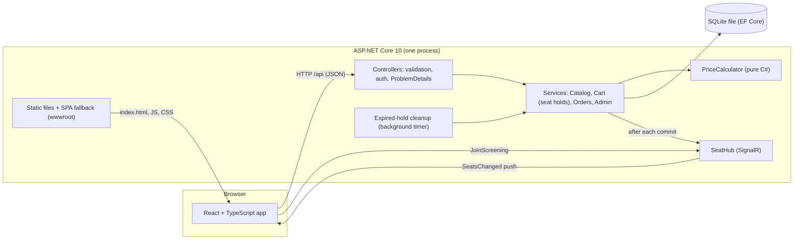
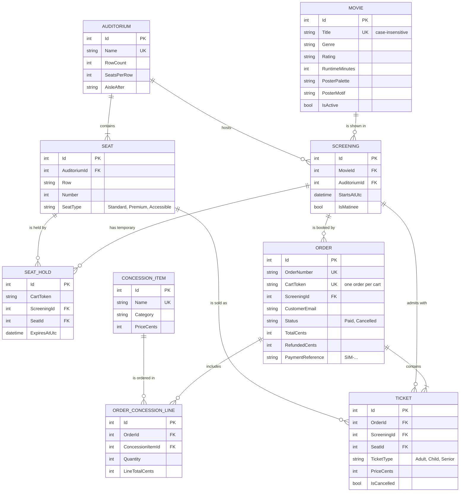

# Movie Theater Ticket System

A full-stack movie theater booking app built with C#, ASP.NET Core, Entity Framework Core, SQLite, React, TypeScript, and Tailwind CSS.

> **This is an expanded portfolio rebuild of Nathanael Haig's academic C# desktop project, rebuilt as a web application. It is not the original coursework submission.** All movies, customers, and orders in it are fictional, and every payment is simulated.

## Overview

The original project was a C# desktop application for movie selection, seat booking, checkout, and ticket and concession pricing. Nathanael designed its user interface flow and implemented the ticket and concession pricing logic.

This rebuild keeps those parts and turns them into a web app with a real database. Customers browse a week of showtimes, pick seats on a seat map that updates live when other people book, add concessions, and check out with a simulated payment. They can look up and cancel orders later. Staff use a password-protected admin dashboard to manage movies, screenings, and reservations and to see sales numbers that come straight from the database.

## Objectives

- Rebuild the original pricing logic (ticket types, matinees, premium seats, concessions, tax) as a tested, server-side module.
- Make it impossible to sell the same seat twice, even when many people click at the same moment.
- Show seat availability in real time without making every browser refresh constantly.
- Keep data in a SQL database that survives restarts, with schema changes tracked as migrations.
- Validate every input on the server and return clear, consistent error responses.
- Build an interface that works with a keyboard and a screen reader and respects reduced-motion settings.
- Back the important rules with automated tests that run in CI.

## Features

Customer side:

- **Showtimes:** a 7-day date strip, a genre filter, and each showtime's auditorium, matinee label, and seats left. The page opens on the first day that still has showtimes left (judged in the theater's time zone), so an evening visitor sees tomorrow instead of an empty page. Picking Today in the strip still shows today.
- **Movie pages:** synopsis, rating, runtime, and the week's showtimes grouped by day.
- **Visual seat map:** standard, premium, and wheelchair-accessible seats, with aisles. Every seat is a button with a full label (for example "Row C seat 7, premium, available"). Arrow keys move between seats. Status is shown by icon and pattern as well as color.
- **Live availability:** seats held or sold by other customers change on screen right away through SignalR. If the live connection drops, the map refreshes every 15 seconds until it reconnects.
- **Seat holds:** choosing a seat holds it for 10 minutes. A countdown shows how long is left, and expired holds are released automatically.
- **Cart:** a ticket type per seat (Adult, Child, Senior), concessions with quantity steppers, and totals calculated by the server.
- **Simulated checkout:** clearly labeled "Simulated checkout — no real payment is processed." There are no card fields. A "Simulate a declined payment" checkbox shows how a failed payment is handled; the seats stay held.
- **Confirmation and order history:** find every order for an email address with any one order number from it.
- **Cancellation:** customers can cancel until 30 minutes before showtime. The seats go back on sale and a simulated refund is recorded.

Admin side (cookie sign-in):

- **Dashboard:** gross sales, tickets sold, concession sales, tax, refunds, sales by movie, concession totals, and seats sold for the next screenings, for any date range.
- **Movies:** add, edit, hide or show, and delete (only if the movie has no screenings), with a live poster preview.
- **Screenings:** schedule, move, or delete. Screenings in the same auditorium can't overlap, including a 20-minute cleaning break. Screenings that already have orders are locked.
- **Reservations:** search by order number, name, or email; filter by status; page through results; view details; cancel with an optional reason.

Under the hood:

- Code-first EF Core migrations that run automatically at startup. On first run the database is created and filled with fictional sample data.
- RFC 9457 ProblemDetails for every error, with a stable `code` field (for example `seat-unavailable`).
- Rate limits on admin sign-in and order lookup.
- An OpenAPI document at `/openapi/v1.json`.
- A health endpoint at `/healthz`.

## Technologies and why

| Technology | Why it is used here |
| --- | --- |
| **C# / ASP.NET Core 10 Web API** | Controllers, model validation, cookie authentication, rate limiting, and ProblemDetails are all built in. It is also the natural next step from the original C# desktop project. |
| **Entity Framework Core 10 + SQLite** | EF Core maps C# classes to tables and tracks schema changes as migrations. SQLite keeps the whole database in one file, so the demo needs no database server. It still supports transactions and the unique (and partial unique) indexes that prevent double-booking. |
| **ASP.NET Core SignalR** | Pushes seat changes to everyone viewing the same showtime. It picks WebSockets when available and falls back to other transports. |
| **React 19 + TypeScript + Vite** | Component-based UI. TypeScript types mirror the API's JSON shapes, so mismatches show up at compile time. Vite gives a fast dev server with a proxy to the API. |
| **React Router 8** | Client-side pages (showtimes, seats, cart, checkout, orders, admin). |
| **Tailwind CSS 4** | Styling with a small set of design tokens (colors, fonts, animations) defined in one CSS file. |
| **xUnit + WebApplicationFactory** | Unit tests for pricing and scheduling, plus integration tests that run the real app in memory against a real SQLite file. |
| **Vitest + Testing Library** | Component and page tests that interact with the UI the way a user does. Only `fetch` and the SignalR connection are faked. |
| **GitHub Actions** | CI workflow that builds and tests both halves on each push. |
| **Docker** | A multi-stage Dockerfile so the app can run on container hosts. |

## Architecture



- One ASP.NET Core process serves the built React app, the REST API, and the SignalR hub, so the demo runs at one address.
- Controllers stay thin. Business rules live in services (`src/MovieTheater.Api/Services`) and pure domain code (`src/MovieTheater.Api/Domain`).
- Every change goes through the REST API and the database. SignalR only announces changes after they are committed, so the database is always the source of truth.

## Data model



Money is stored as whole cents (`int`) so there are no rounding surprises and SQL `SUM` works directly in reports. Times are stored in UTC and converted to theater-local time for display and for the matinee rule.

## How double-booking is prevented

Selling a seat is a two-step process: **hold**, then **buy**. Each step is protected twice.

1. **Holding a seat** (`POST /api/carts/{token}/holds`) runs inside a write transaction. Microsoft.Data.Sqlite starts these with `BEGIN IMMEDIATE`, which takes SQLite's write lock up front, so two requests for the same seat are handled one after the other. The second one sees the first hold and gets **409 Conflict** (`seat-unavailable`).
2. **A unique index on `SeatHolds (ScreeningId, SeatId)`** means the database itself refuses a second hold, even if application code had a bug.
3. **Buying** (`POST /api/orders`) only accepts the exact seats the cart is holding, with holds that have not expired. It inserts the tickets and deletes the holds in one transaction.
4. **A partial unique index on `Tickets (ScreeningId, SeatId) WHERE IsCancelled = 0`** means a seat can have only one active ticket per screening. Cancelled tickets stay in the table as history, and the seat can be sold again.
5. **One order per cart:** `Orders.CartToken` is unique. A double-clicked or retried checkout returns the existing order (200) instead of charging twice.

Holds expire after 10 minutes. Every query ignores expired holds, and a background job deletes them every 30 seconds and tells seat-map viewers those seats are free again.

The tests prove this. For example, `Concurrent_holds_on_one_seat_let_exactly_one_cart_win` releases 12 hold requests for the same seat at the same moment and checks that exactly one succeeds and 11 get 409. `Concurrent_customers_booking_the_same_seat_produce_exactly_one_order` does the same for the full hold-and-checkout flow.

## Pricing rules

All prices are calculated on the server by `PriceCalculator` (`src/MovieTheater.Api/Domain/Pricing.cs`). The browser only sends seat ids, ticket types, and quantities; any price it sends is ignored.

| Rule | Default | Setting |
| --- | --- | --- |
| Adult / Child / Senior base price | $14.50 / $10.50 / $11.50 | `Pricing:AdultCents`, `ChildCents`, `SeniorCents` |
| Matinee discount (each ticket) | $3.00 off, never below $0 | `Pricing:MatineeDiscountCents` |
| What counts as a matinee | Starts before 4:00 PM theater time | `Pricing:MatineeCutoffHour` |
| Premium seat surcharge | +$3.50 | `Pricing:PremiumSurchargeCents` |
| Accessible seats | Same price as standard | (rule in code) |
| Sales tax | 7.75%, rounded half away from zero to the cent | `Pricing:SalesTaxRate` |
| What is taxed | Concessions only | `Pricing:TaxTickets` (set `true` to tax tickets too) |

The tax rate and what it applies to are demo settings, not tax advice. Concession prices are stored in the `ConcessionItems` table.

Example: an evening premium adult ticket ($14.50 + $3.50), a child ticket ($10.50), and two small popcorns ($13.00) come to $41.50 before tax. Tax is 7.75% of $13.00, which is $1.01, for a total of $42.51.

## Setup

Prerequisites:

- [.NET SDK 10](https://dotnet.microsoft.com/download) (this project was built and tested with 10.0.404; `global.json` accepts any 10.0 SDK at 10.0.100 or later)
- [Node.js](https://nodejs.org/) 22.22 or later (tested with 26.13.0) and npm
- Windows, macOS, or Linux. Everything was tested on Windows 11.

Get the code and install dependencies:

```bash
cd movie-theater-ticket-system          # this folder
dotnet restore MovieTheater.slnx
npm ci --prefix client
```

NuGet packages come from nuget.org through the `nuget.config` in this folder. The EF Core command-line tool is a local tool (`dotnet tool restore` installs it inside the project).

## Running the local demo

```bash
dotnet run --project src/MovieTheater.Api
```

Then open **http://localhost:5301**.

- The first `dotnet run` builds the React client into `src/MovieTheater.Api/wwwroot` if it isn't built yet (it runs `npm ci` if needed, then `npm run build`). After you change client code, run `npm run build --prefix client` again, or use the dev server below.
- On startup the app applies migrations and, if the database is empty, adds the sample data: 8 fictional movies, 3 auditoriums (236 seats), 77 screenings over 7 days starting today, 9 concession items, and 7 sample orders.
- The database is `src/MovieTheater.Api/App_Data/movie-theater.db`. It is gitignored and survives restarts.
- **Reset everything** (for example when the week of sample showtimes runs out):

  ```bash
  dotnet run --project src/MovieTheater.Api -- --reset-database
  ```

**Demo admin login (local only).** Open http://localhost:5301/admin and sign in with username `admin` and password `LocalDemo-2026`. These come from `src/MovieTheater.Api/appsettings.Development.json`. They are a local demo credential for this portfolio project, not a real account, and they are not included in published builds. To change them, either edit that file or set an environment variable before starting the app:

```powershell
$env:DemoAdmin__Password = "pick-your-own"   # PowerShell
```

```bash
export DemoAdmin__Password="pick-your-own"     # bash
```

If no password is configured (the default outside Development), admin sign-in is turned off and the login endpoint returns 503.

**Sample order to look up:** on the My Orders page, use order `MT-SEED0001` with `jordan.rivera@example.com`.

**Development mode with hot reload** (two terminals):

```bash
dotnet run --project src/MovieTheater.Api      # API on http://localhost:5301
npm run dev --prefix client                     # Vite on http://localhost:5302
```

Open http://localhost:5302. Vite forwards `/api` and `/hubs` (including WebSockets) to the API.

**Quick HTTP check of a running app** (Windows PowerShell):

```powershell
powershell -ExecutionPolicy Bypass -File scripts/smoke-test.ps1
```

It walks through browse, hold, a deliberate double-booking attempt, quote, checkout, history, cancel, and admin access, and prints PASS or FAIL for each step. It creates one order and then cancels it.

## Recording a demo video

A 2–3 minute screen recording is enough. Suggested checklist:

1. Start fresh: `dotnet run --project src/MovieTheater.Api -- --reset-database`.
2. Show the home page, switch dates, and filter by genre.
3. Open a movie, then an evening showtime.
4. Open the same showtime in a second browser window side by side. Pick a seat in one window and show it turn "held" in the other without refreshing.
5. Try to pick that same seat in the second window to show the "being held by another customer" message.
6. Use the keyboard (Tab, then arrow keys, then Enter) to pick a seat, to show the accessible seat map.
7. In the cart, change a ticket to Child, add popcorn, and point out the server-calculated totals and the hold countdown.
8. At checkout, show the "Simulated checkout" notice. Try the "Simulate a declined payment" box once, then complete the simulated payment.
9. Look up the order on My Orders and cancel it. Show the seat become available again in the other window.
10. Sign in to the admin dashboard. Show the sales numbers, try to schedule an overlapping screening to show the conflict message, and cancel a reservation.
11. End on the About page, which says this is an expanded portfolio rebuild of the academic project.

Tips: record at 1920×1080 with browser zoom around 110%, hide bookmarks and notifications, and don't show real personal information. Windows has a built-in recorder in the Snipping Tool (or Xbox Game Bar with Win+Alt+R).

## Testing

```bash
# Backend: 136 xUnit tests (46 unit, 90 integration against real SQLite files)
dotnet test MovieTheater.slnx

# Backend coverage (Cobertura XML in TestResults/)
dotnet test MovieTheater.slnx --settings tests/coverage.runsettings --collect "XPlat Code Coverage" --results-directory TestResults

# Frontend: 48 Vitest + Testing Library tests, plus lint, typecheck, and production build
cd client
npm test
npm run test:coverage
npm run lint
npm run typecheck
npm run build
```

What the tests cover:

- **Pricing** (25 unit tests): every ticket type, matinee discount and its floor, premium surcharge, accessible pricing, tax rounding, tax on/off for tickets, quote totals.
- **Scheduling** (10 unit tests): overlap rules with the cleaning buffer, back-to-back screenings, editing a screening without conflicting with itself.
- **Double-booking** (8 tests): concurrent holds, concurrent full bookings, five simultaneous checkouts of one cart, and direct inserts that the unique indexes must reject.
- **Seat holds**: expiry at exactly 10 minutes (using a fake clock), shared cart expiry, cleanup job.
- **Booking flow**: browse → hold → quote → checkout → history → cancel → resell, client-sent prices ignored, simulated decline.
- **Cancellation rules**: the 30-minute cutoff, double cancel, wrong email, admin override.
- **Validation**: 400 ProblemDetails with field errors for bad input; 404 and 409 with stable codes.
- **Admin**: all 13 admin endpoints return 401 without the cookie; sign-in, logout, rate limiting, movie CRUD, overlap checks, locked screenings, search, and the sales report.
- **SignalR**: a real SignalR client connected to the in-memory server receives hold, release, sold, cancel, and expiry messages, and only for the screening it joined.
- **Seed data**: counts, no overlapping screenings, sample orders priced by the real rules, data kept across restarts.
- **Showtime listing and health check**: the default day after today's last show has started, an explicitly picked empty day, the theater time zone (not UTC) deciding what "today" is, and `/healthz` answering without sign-in.
- **Frontend**: the default-date choice on the home page, seat map labels and keyboard navigation, totals display, checkout form validation and what is sent to the server, cart re-pricing, order lookup and cancel dialog, live seat updates and the polling fallback, admin sign-in and forms.

Measured coverage (on Windows 11, .NET 10.0.404, Node 26.13.0):

- Backend, hand-written code (EF Core migrations and build-tool output under `obj/` excluded): **95.2% of lines** (1858/1951), **79.9% of branches** (275/344).
- Frontend (`client/src`, tests excluded): **78.59% of lines** (793/1009), **73.07% of branches** (646/884).

## Performance (measured locally)

Measured on one Windows 11 development machine with `dotnet run` (Development mode, SQLite with sample data), using 50 sequential `curl` requests per endpoint after a short warm-up. Network latency is not included, and this is not a load test.

| Request | Median | 95th percentile |
| --- | --- | --- |
| `GET /api/showtimes?date=…` | 6.4 ms | 7.2 ms |
| `GET /api/screenings/{id}` (full seat map) | 5.7 ms | 6.1 ms |
| `POST /api/orders/quote` | 6.2 ms | 6.9 ms |
| `GET /` (index.html) | 4.6 ms | 5.0 ms |

Production client build: 419.9 kB JavaScript (124.1 kB gzipped) and 48.5 kB CSS (9.1 kB gzipped).

## Hosting

**Live demo:** https://movie-theater-ticket-system.onrender.com, on Render, deployed with the repository root's `render.yaml` Blueprint. Render's free plan puts the service to sleep after 15 minutes idle, the first visit after that takes about 50 seconds, and the demo data resets on every restart. The other options below were not tried.

**Why GitHub Pages can't host this app:** GitHub Pages only serves static files (HTML, CSS, JavaScript). This app needs a server that runs ASP.NET Core, keeps a SQLite database, and holds open SignalR connections. The React part could be served from Pages, but without the API it can't show showtimes or take orders.

**Docker:** the `Dockerfile` in this folder builds the React client with Node 26.13.0, publishes the API with the .NET 10.0.404 SDK, and runs it on the ASP.NET Core 10.0.15 runtime image as a non-root user. Docker wasn't available on the machine this was built on, so Render's build was the first build of the image; it now runs the live demo. To test it on a machine with Docker:

```bash
docker build -t movie-theater-ticket-system .
docker run --rm -p 8080:8080 -e DemoAdmin__Password=choose-a-password movie-theater-ticket-system
# then open http://localhost:8080, or run:
# powershell -File scripts/smoke-test.ps1 -BaseUrl http://localhost:8080 -AdminPassword choose-a-password
```

How the app behaves when hosted (this part was tested locally with a Release build in Production mode):

- **Port:** if the host sets a `PORT` environment variable, the app listens on that port on all interfaces. Otherwise it uses `ASPNETCORE_URLS` / `ASPNETCORE_HTTP_PORTS` if set (the Docker base image sets port 8080), and falls back to 5301.
- **Database:** created, migrated, and seeded on startup when it doesn't exist. **Most free hosts give containers a temporary disk, so all orders and changes are lost and the sample data is recreated whenever the host restarts or redeploys.** For data that lasts, attach a persistent volume and point `Storage:DataDirectory` at it.
- **Admin password:** must come from configuration, for example the `DemoAdmin__Password` environment variable or the host's secret settings. Without it, admin sign-in is off. No password is built into the image.
- **Behind a proxy:** most hosts terminate HTTPS at a proxy. Setting `ASPNETCORE_FORWARDEDHEADERS_ENABLED=true` makes the app trust the proxy's `X-Forwarded-For`/`X-Forwarded-Proto` headers. Only set it when the app really is behind the host's proxy, because those headers can be faked otherwise, which would also weaken the per-IP rate limits.

Realistic options (only Render has been used, as described below; check each provider's current pricing, limits, WebSocket support, and persistent disk options before choosing another):

- A container platform that builds from a Dockerfile, such as Render, Railway, Fly.io, Google Cloud Run, or Azure Container Apps.
- Azure App Service (Linux) with the Docker image or a direct .NET publish.
- A small virtual machine running the Docker image behind a reverse proxy.

**Render (the chosen host, deployed):** the repository root's `render.yaml` Blueprint sets this up. It builds the Dockerfile, uses `/healthz` as the health check, and sets `Theater__TimeZone=America/Los_Angeles`, `ASPNETCORE_FORWARDEDHEADERS_ENABLED=true`, and `PORT=10000` (Render's default port). Render asks for `DemoAdmin__Password` (a secret you choose) when the Blueprint is created. The full list, with what each one does, is in [docs/DEPLOYMENT.md](docs/DEPLOYMENT.md#render).

More detail, including how this folder works inside a larger repository, is in [docs/DEPLOYMENT.md](docs/DEPLOYMENT.md).

## Project structure

```
apps/movie-theater-ticket-system/
├── src/MovieTheater.Api/        ASP.NET Core app (API, SignalR hub, serves the client)
│   ├── Controllers/             Thin HTTP endpoints
│   ├── Services/                Booking, cart holds, orders, admin, reports
│   ├── Domain/                  Entities, PriceCalculator, ScreeningSchedule
│   ├── Data/                    DbContext, migrations, sample data
│   ├── Hubs/                    SeatHub (SignalR)
│   └── Contracts/               Request/response types with validation attributes
├── tests/MovieTheater.Tests/    xUnit unit and integration tests
├── client/                      React + TypeScript + Vite + Tailwind
│   └── src/                     api/, components/, pages/, state/, hooks/
├── scripts/smoke-test.ps1       HTTP check of a running app
├── docs/                        Walkthrough, deployment notes, screenshot list
└── Dockerfile                   Container build (runs the live demo on Render)
```

The app lives in `apps/movie-theater-ticket-system/` of the [enobot/nate](https://github.com/enobot/nate) repository. Its CI workflow is at the repository root in [`.github/workflows/movie-theater-ci.yml`](../../.github/workflows/movie-theater-ci.yml), and the repository root's [`render.yaml`](../../render.yaml) Blueprint describes its Render service.

## Challenges

These are the technical problems the design had to solve:

- **Two people clicking the same seat at the same time.** Checking "is the seat free?" and then saving leaves a gap where another request can slip in. Write transactions close the gap, and unique indexes make the database the final judge. The concurrency tests fire 12 requests at once to prove it.
- **Seats stuck in abandoned carts.** Holds carry an expiry time. Queries treat expired holds as free immediately, and a background job cleans them up and notifies viewers.
- **Keeping many browsers in sync.** SignalR groups send updates only to people viewing that showtime. After a reconnect the page reloads the seat map, because messages sent while it was offline are not replayed.
- **Not trusting the browser.** Prices, seat types, and concession names are always loaded from the database at quote and checkout time. A test sends fake prices to prove they are ignored.
- **Retries and double clicks.** Making checkout idempotent by cart token means a retried request can't create a second order.
- **Time zones.** Matinee pricing depends on the theater's local time, while storage is in UTC. The API sends theater wall-clock times without an offset so the browser can't shift them.
- **Money in SQLite.** SQLite has no decimal type, so amounts are stored as integer cents.
- **An accessible seat map.** A grid of seats is easy to draw and easy to make unusable without a mouse. Each seat is a labeled button with roving focus and arrow-key movement. A component test caught one screen-reader label problem (missing spaces in hidden button text), which was fixed.

## What's next

- Cancel individual tickets instead of whole orders.
- Customer accounts with ASP.NET Core Identity, and email confirmations.
- A payment provider's sandbox mode in place of the simulated payment.
- Admin management of the concession menu and auditorium layouts.
- PostgreSQL and a SignalR backplane if the app ever needs to run on more than one server.
- A Content Security Policy header and browser-based end-to-end tests.
- Loading the SignalR client and admin pages only when needed, to shrink the first download.

## License

[MIT](LICENSE). Copyright (c) 2026 Nathanael Haig and Tracy Tran.

## Credits

- **Nathanael Haig** and **Tracy Tran**: this portfolio rebuild.
- **Nathanael Haig**: the original academic C# desktop project (Information Systems, California State University, Fullerton).
- Movie titles, synopses, customers, and poster art are original and fictional. Any resemblance to real films is a coincidence.
